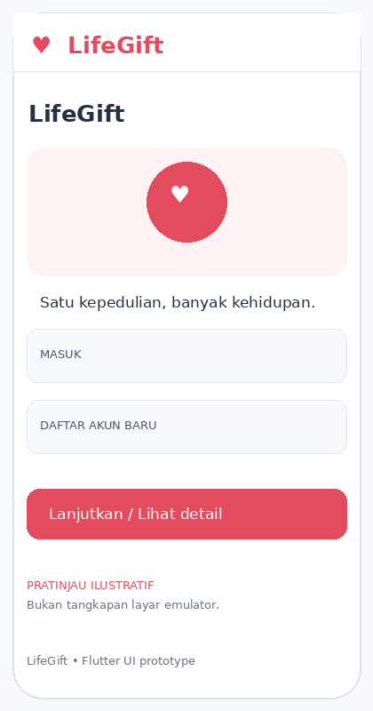
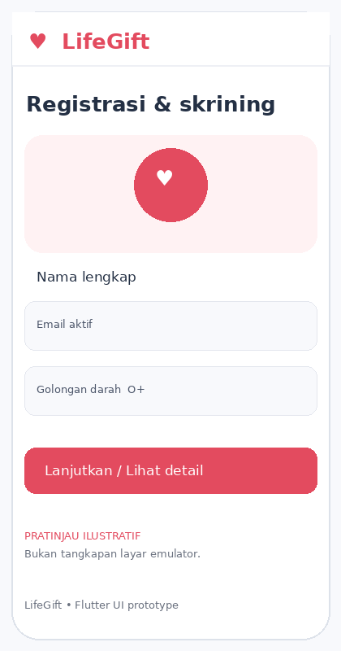
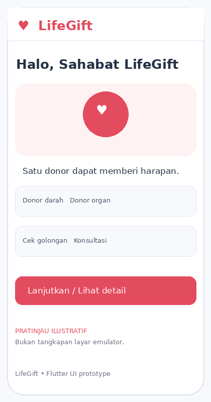
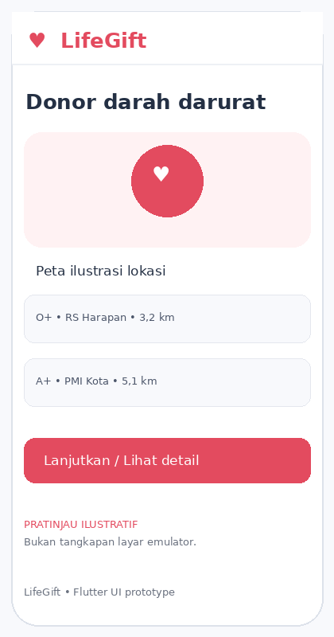
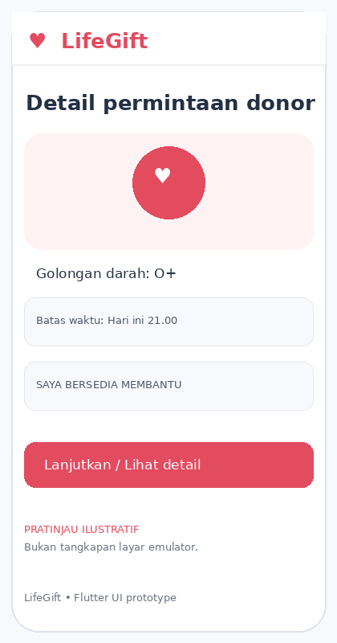
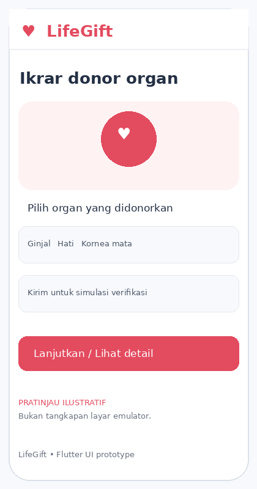
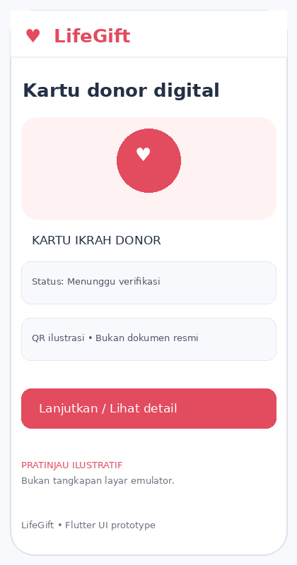
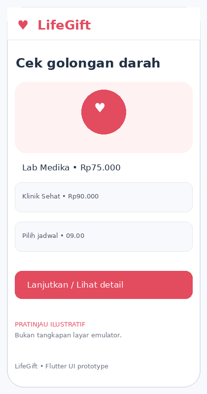
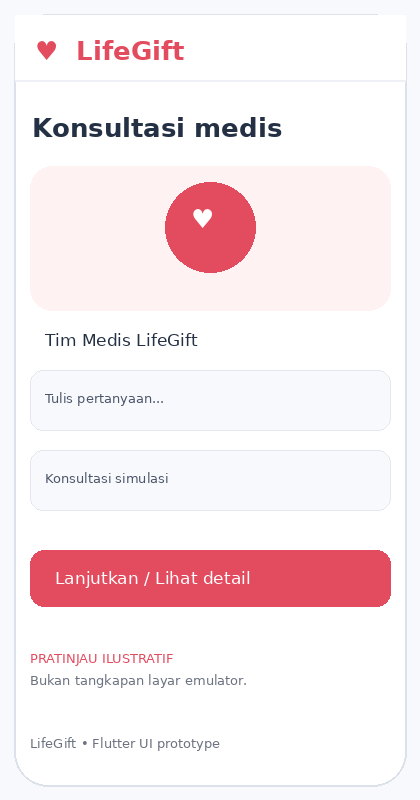
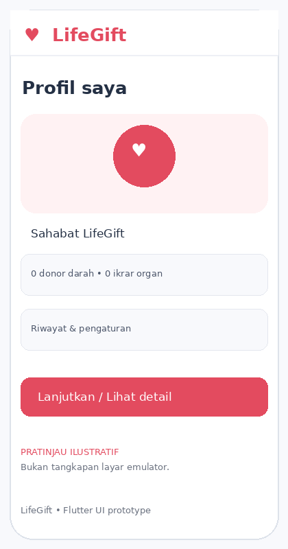

# LifeGift — Flutter Front-End

LifeGift adalah prototipe front-end aplikasi donor darah dan organ digital untuk tugas pengembangan Mobile Front-End & HealthTech. Proyek ini menggunakan Flutter dan Material 3.

## Fitur yang tersedia pada prototipe
- Splash/welcome, halaman masuk, dan registrasi dengan validasi form dasar.
- Dashboard dengan ringkasan kontribusi dan akses cepat ke modul.
- Donor darah: daftar permintaan demo, filter golongan darah/jarak, detail permintaan, dan tombol kesediaan.
- Donor organ: pilihan organ, persetujuan keluarga, simulasi verifikasi, dan kartu donor digital ilustratif.
- Cek golongan darah: pilihan laboratorium, harga simulasi, dan pilihan jadwal.
- Konsultasi medis: UI chat lokal untuk demonstrasi.
- Profil: statistik kontribusi, riwayat placeholder, pengingat, dan tombol keluar.

## Teknologi
- Flutter / Dart
- Material 3
- StatefulWidget untuk interaksi lokal
- Tidak memerlukan API key atau backend untuk menjalankan demo

## Cara menjalankan
1. Install Flutter SDK dan pastikan `flutter doctor` tidak menunjukkan masalah kritis.
2. Ekstrak folder proyek.
3. Buka terminal pada folder `lifegift_flutter`.
4. Jalankan:
   ```bash
   flutter pub get
   flutter run
   ```
5. Untuk menjalankan pada emulator Android, nyalakan emulator terlebih dahulu atau sambungkan perangkat dengan USB debugging.

## Struktur proyek
```text
lifegift_flutter/
├── assets/
│   └── screenshots/        # Pratinjau ilustratif layar
├── lib/
│   └── main.dart           # Source code UI utama
├── pubspec.yaml
├── README.md
└── LOGBOOK.md
```

## Pratinjau tampilan
Gambar berikut adalah **pratinjau ilustratif UI**, bukan screenshot hasil eksekusi emulator. Setelah menjalankan aplikasi, ambil screenshot asli dari emulator/perangkat dan ganti gambar ini jika dosen mensyaratkan bukti aplikasi berjalan.

### 1. Onboarding


### 2. Registrasi


### 3. Beranda


### 4. Donor darah


### 5. Detail permintaan


### 6. Registrasi donor organ


### 7. Kartu donor digital


### 8. Cek golongan darah


### 9. Konsultasi


### 10. Profil


## Catatan penting
- Ini merupakan **front-end prototype**. Login/registrasi belum memakai backend, data permintaan dan harga bersifat simulasi, GPS/peta belum terhubung, upload dokumen belum tersedia, QR bukan QR resmi, chat tidak terhubung ke dokter, dan pemesanan lab tidak dikirim ke fasilitas kesehatan.
- Jangan memasukkan data pribadi atau data medis nyata ke prototipe.
- Fitur donor darah maupun donor organ harus mengikuti skrining, regulasi, dan prosedur fasilitas kesehatan resmi. Aplikasi ini tidak menggantikan nasihat tenaga medis.

## GitHub
Untuk mengumpulkan, buat repository di akun GitHub ketua kelompok lalu unggah seluruh isi folder ini. Contoh:
```bash
git init
git add .
git commit -m "Initial LifeGift Flutter front-end"
git branch -M main
git remote add origin https://github.com/USERNAME-KETUA/lifegift-flutter.git
git push -u origin main
```
Ganti URL remote dengan URL repository ketua kelompok yang sebenarnya. Setelah berhasil, kumpulkan link repository GitHub tersebut dan file `LOGBOOK.md`.
